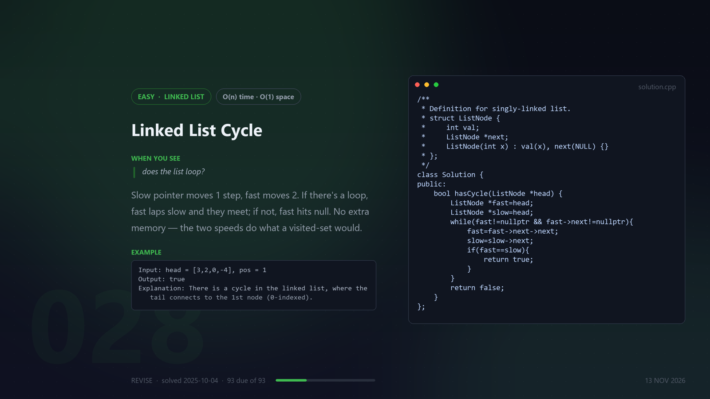

# DSA Revision Wallpaper



Every day, your desktop shows a problem **you already solved** —
description + example on the left, your complete submitted C++ solution
on the right — so the grind sticks.

## How it works

- The solved list comes from the GitHub repo
  `chiragduhoon/leetcode-solutions` — refreshed on every run via the
  GitHub API into [solved.json](solved.json) (cached copy used offline).
- [solutions.json](solutions.json) — a revision card per problem:
  "when you see" signal, plain-words approach with the common trap,
  Big-O, and a fallback code snippet. 93 of 101 repo problems carded
  (skipped: 3 SQL/pandas, 5 unverifiable contest problems).
- Problems are matched to cards by normalized name; difficulty, solved
  date, and `next_revision_date` are enriched from the whooppp tracker
  when logged there. Picks from problems **due for revision**, rotating
  daily. Accent = difficulty (green Easy, amber Medium, red Hard).
- **Two-column layout**: LEFT has the description/approach plus an
  **EXAMPLE box** (Input/Output parsed from the problem's README in the
  repo); RIGHT has your complete submitted `solution.cpp` — exactly as
  written, blank lines and all. Both fetched from GitHub and cached in
  `cache/`; the code font auto-shrinks to fit.

Rendering: Pillow at native resolution; wallpaper set via
`SystemParametersInfoW`. If no card is available the script exits and
keeps the current wallpaper.

## Files

| File | Purpose |
|---|---|
| `wallpaper.py` | the whole thing |
| `solutions.json` | revision cards (93 problems) |
| `solved.json` | solved-list snapshot from GitHub (auto-refreshed) |
| `cache/` | downloaded solutions + READMEs (auto-filled) |
| `today.png` | the rendered wallpaper (auto-generated) |

## Scheduling (already set up)

- Task Scheduler task **"CS Fact Wallpaper"** runs daily at 8:00 AM.
- A Startup-folder shortcut refreshes it at every logon.

## Manual run

```
python wallpaper.py
```

## Customizing

- **New solved problem**: just solve it — leet2git pushes it to GitHub and
  the wallpaper picks up the new folder automatically. For it to appear it
  needs a card: ask Claude to "add cards for uncarded problems" and it will
  diff `solved.json` against `solutions.json` and fill the gaps.
- **Colors**: edit `DIFFICULTY_COLORS` / `PANEL` in `wallpaper.py`.
- **Layout**: everything scales from a 1080p design via `scale`.

## Removing

```
schtasks /Delete /TN "CS Fact Wallpaper" /F
del "%APPDATA%\Microsoft\Windows\Start Menu\Programs\Startup\CS Fact Wallpaper.lnk"
```
